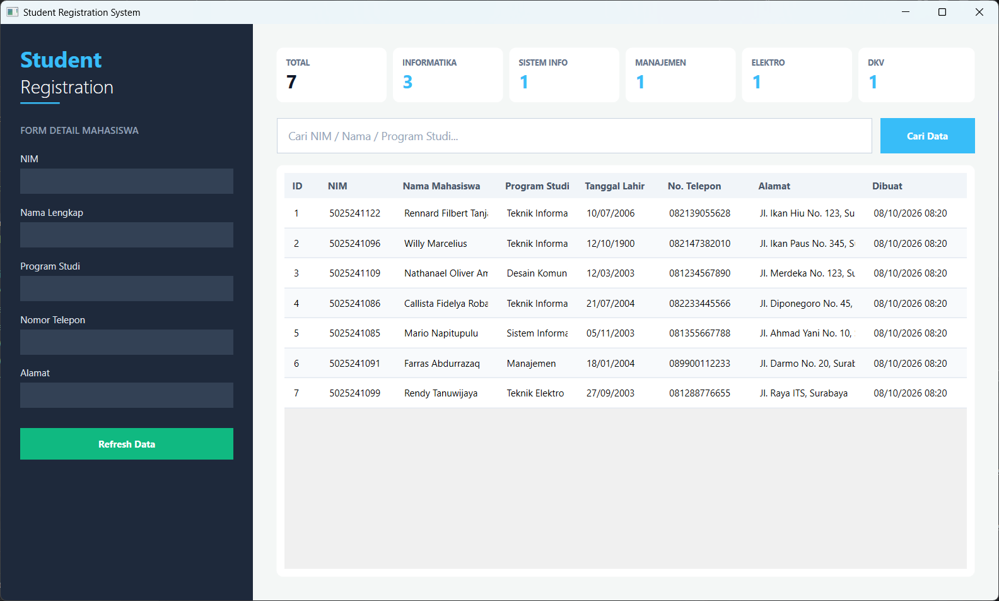
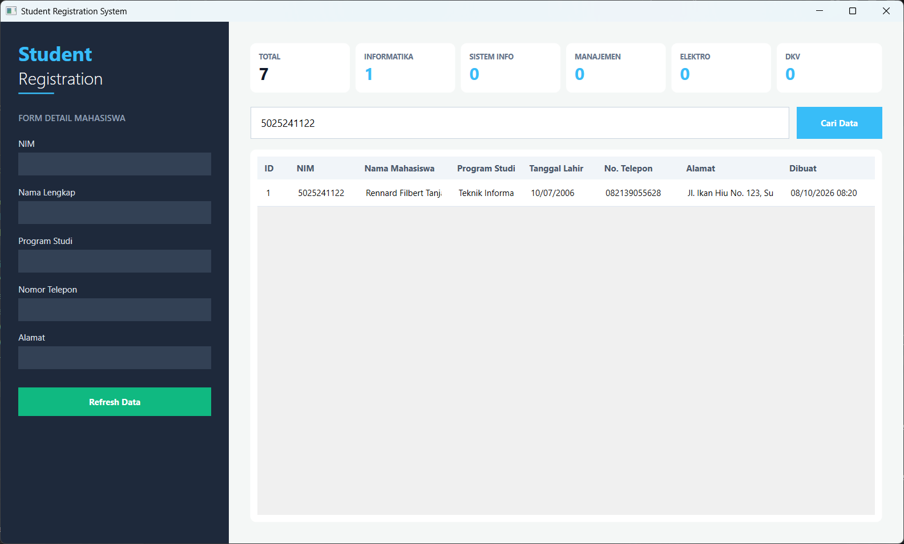

# Latihan 4 — Pemrograman Berbasis Kerangka Kerja (PBKK)

| Detail | Keterangan |
| --- | --- |
| **Nama Lengkap** | Rennard Filbert Tanjaya |
| **NRP** | 5025241122 |
| **Mata Kuliah** | Pemrograman Berbasis Kerangka Kerja |
| **Kelas** | D |

---

# Student Registration System (C# WPF + SQL Server)

Aplikasi desktop pengelolaan dan registrasi data mahasiswa yang dibangun menggunakan **C#**, **.NET 8**, dan **WPF (Windows Presentation Foundation)**. Aplikasi ini terhubung langsung ke **SQL Server Database (`StudentRegistrationDB`)** menggunakan **ADO.NET** (`Microsoft.Data.SqlClient`) dan menerapkan pola arsitektur **MVVM (Model-View-ViewModel)**.

---

## Fitur Utama

- **Integrasi Database Relasional (ADO.NET)**
  Penarikan data mahasiswa terintegrasi dari tabel `Students` dan `Programs` menggunakan kueri SQL `INNER JOIN` secara langsung dari SQL Server melalui `SqlConnection`, `SqlCommand`, dan `SqlDataReader`.

- **Dashboard Statistik Interaktif**
  Kartu HUD ringkasan yang menampilkan total mahasiswa (diambil langsung via `SELECT COUNT(*)`) serta sebaran statistik mahasiswa berdasarkan Program Studi (Teknik Informatika, Sistem Informasi, Manajemen, Teknik Elektro, dan Desain Komunikasi Visual).

- **Pencarian Real-Time Terparameterisasi**
  Bilah pencarian dinamis (`Cari NIM / Nama / Program Studi...`) yang memfilter data secara instan menggunakan *parameterized SQL query* (`LIKE @Keyword`) untuk menjamin keamanan dari SQL Injection.

- **Detail Panel View (Sidebar)**
  Panel kiri yang menampilkan rincian data mahasiswa terpilih dari tabel secara otomatis menggunakan *Two-Way Data Binding*.

- **Arsitektur MVVM & Clean DataGrid UI**
  Pemisahan logika bisnis (*Data Access Layer*) dan antarmuka (*UI*) menggunakan `RelayCommand` dan `INotifyPropertyChanged`. Tampilan DataGrid dilengkapi *custom styling*, *cell padding*, serta pengurutan data teratur berdasarkan ID (`ASC`).

---

## Struktur Database (T-SQL)

Aplikasi menggunakan database **`StudentRegistrationDB`** dengan relasi **1:N (One-to-Many)** antara tabel `Programs` dan `Students`:

```sql
-- Tabel Program Studi
CREATE TABLE Programs (
    ProgramId INT IDENTITY(1,1) CONSTRAINT PK_Programs PRIMARY KEY,
    ProgramCode VARCHAR(20) NOT NULL CONSTRAINT UQ_Programs_ProgramCode UNIQUE,
    ProgramName VARCHAR(100) NOT NULL,
    IsActive BIT NOT NULL CONSTRAINT DF_Programs_IsActive DEFAULT 1,
    CreatedAt DATETIME2 NOT NULL CONSTRAINT DF_Programs_CreatedAt DEFAULT SYSDATETIME()
);

-- Tabel Mahasiswa (dengan Foreign Key)
CREATE TABLE Students (
    StudentId INT IDENTITY(1,1) CONSTRAINT PK_Students PRIMARY KEY,
    NIM VARCHAR(20) NOT NULL CONSTRAINT UQ_Students_NIM UNIQUE,
    Name VARCHAR(100) NOT NULL,
    ProgramId INT NOT NULL,
    BirthDate DATE NULL,
    Address VARCHAR(250) NULL,
    PhoneNumber VARCHAR(20) NULL,
    CreatedAt DATETIME2 NOT NULL CONSTRAINT DF_Students_CreatedAt DEFAULT SYSDATETIME(),
    UpdatedAt DATETIME2 NULL,
    CONSTRAINT FK_Students_Programs FOREIGN KEY (ProgramId) REFERENCES Programs(ProgramId)
);
```

---

## Struktur Project

```plaintext
StudentRegistration/
│
├── Models/
│   ├── Program.cs             # Model entitas Program Studi
│   └── Student.cs             # Model entitas Student (penampung data tergabung)
├── Repositories/
│   └── StudentRepository.cs   # Data Access Layer ke SQL Server via ADO.NET
├── ViewModels/
│   ├── RelayCommand.cs        # Implementasi ICommand untuk binding event ke ViewModel
│   └── StudentViewModel.cs    # Logika bisnis, kueri statistik, & pemrosesan filter pencarian
├── MainWindow.xaml            # Desain antarmuka UI (Dark Mode Sidebar, Cards, & DataGrid)
├── MainWindow.xaml.cs         # Code-behind untuk penautan DataContext ke ViewModel
├── App.xaml                   # Konfigurasi aplikasi
└── App.xaml.cs                # Entry point aplikasi
```

---

## Cara Build dan Menjalankan Project

1. **Setup Database SQL Server:**
   Jalankan script T-SQL di atas pada **SQL Server Management Studio (SSMS)** untuk membuat `StudentRegistrationDB` beserta tabel `Programs` dan `Students`.

2. **Masuk ke folder project:**
   ```bash
   cd StudentRegistration
   ```

3. **Install Package ADO.NET:**
   ```bash
   dotnet add package Microsoft.Data.SqlClient
   ```

4. **Jalankan Aplikasi:**
   ```bash
   dotnet run
   ```

---

## Skenario Pengujian

| Kasus Uji | Langkah Pengujian | Expected Output | Status |
|---|---|---|---|
| **Koneksi SQL Server** | Jalankan aplikasi `dotnet run` | Aplikasi berhasil terhubung ke SQL Server dan menampilkan data | Sesuai |
| **Menampilkan Data JOIN** | Amati isi DataGrid | Nama Program Studi muncul dengan benar hasil dari `INNER JOIN` | Sesuai |
| **Statistik Total Mahasiswa** | Amati kartu "TOTAL MAHASISWA" | Angka statistik sesuai dengan hasil `SELECT COUNT(*)` dari database | Sesuai |
| **Pencarian Data** | Masukkan kata kunci pada Search Bar → klik `Cari Data` | DataGrid memfilter baris berdasarkan NIM, Nama, atau Program Studi | Sesuai |
| **Detail Select Row** | Klik salah satu baris di DataGrid | Data mahasiswa yang dipilih tampil pada form readonly di Sidebar | Sesuai |
| **Refresh Data** | Klik tombol `Refresh Data` | Aplikasi mengambil ulang seluruh data terbaru dari SQL Server | Sesuai |

---

## Tampilan Aplikasi

### Dashboard Utama



### Pencarian & Filter Data



---

## Catatan Arsitektur

- **Repository Pattern & ADO.NET**
  Akses database dibungkus secara rapi dalam `StudentRepository.cs`. Penggunaan `using var` memastikan koneksi `SqlConnection` dan `SqlDataReader` selalu dibuang secara otomatis dari memori.

- **Keamanan Parameterized Queries**
  Seluruh pencarian menggunakan `command.Parameters.AddWithValue()`, mencegah celah serangan *SQL Injection*.

- **Relasi Foreign Key (1:N)**
  Penggunaan relasi PK-FK menjaga integritas data di mana satu mahasiswa harus terdaftar pada satu Program Studi yang valid.