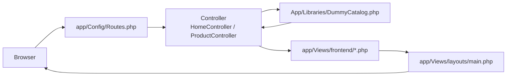
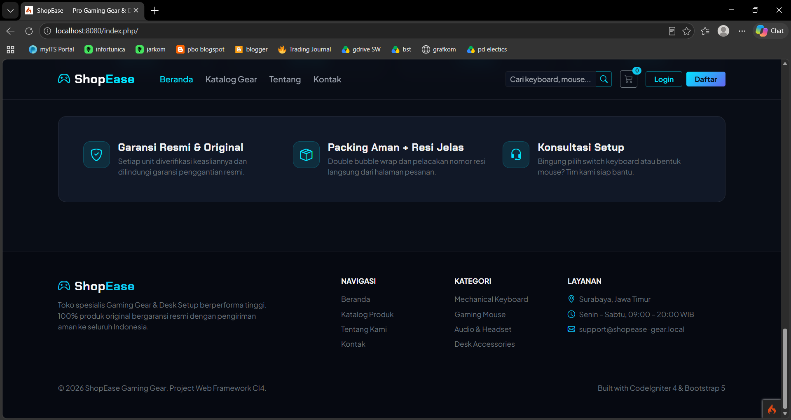
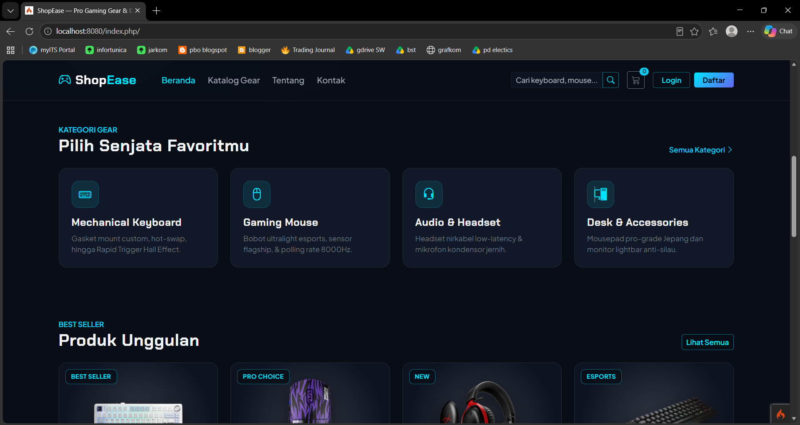
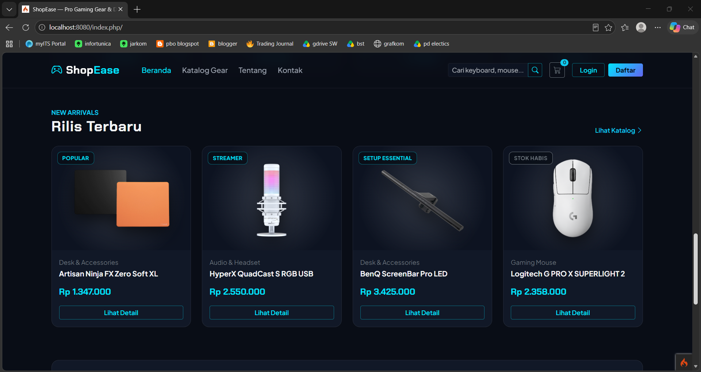
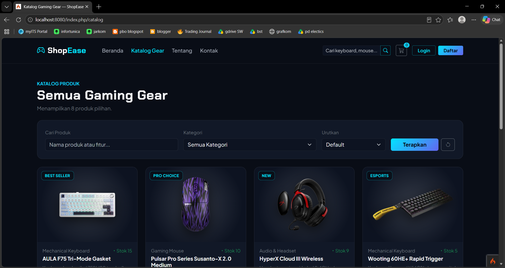
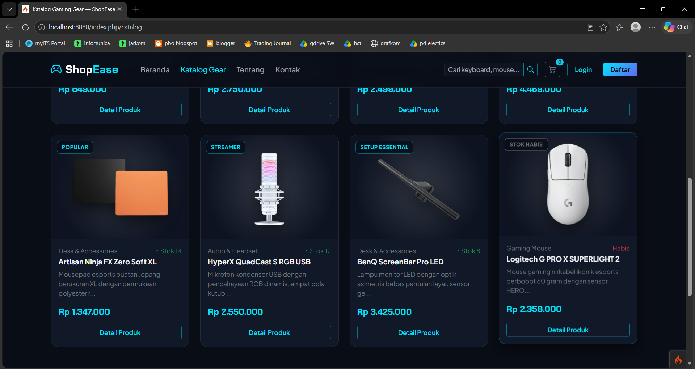
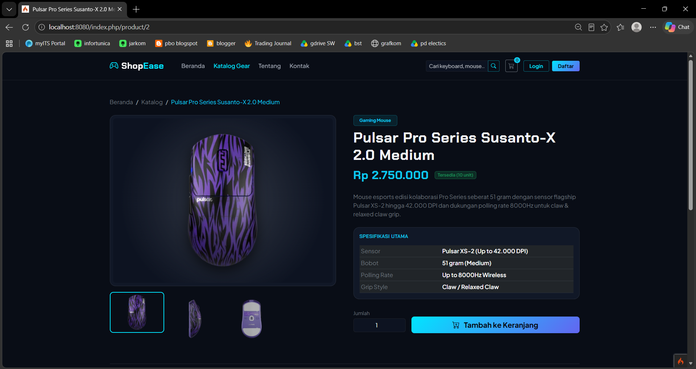
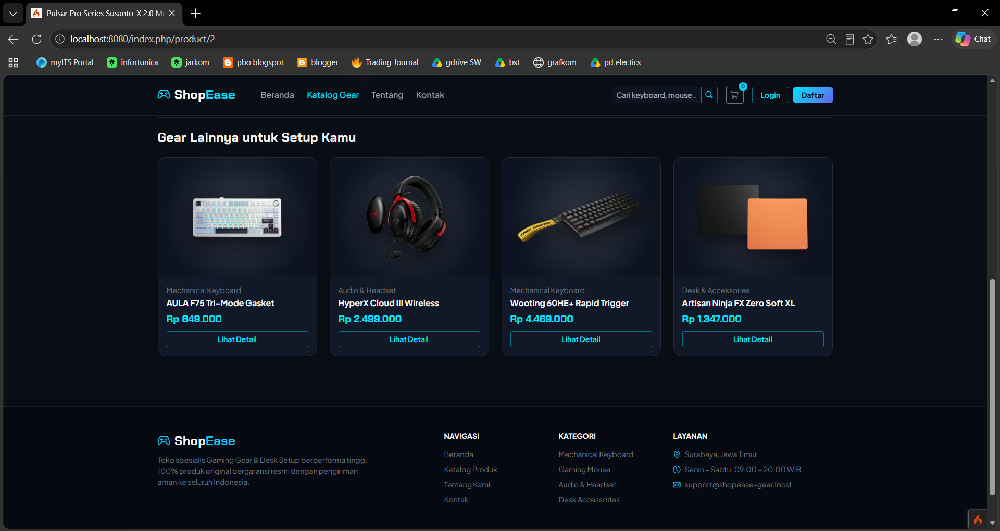
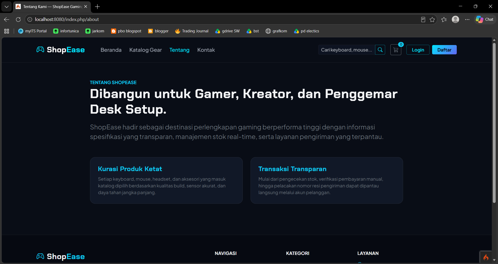
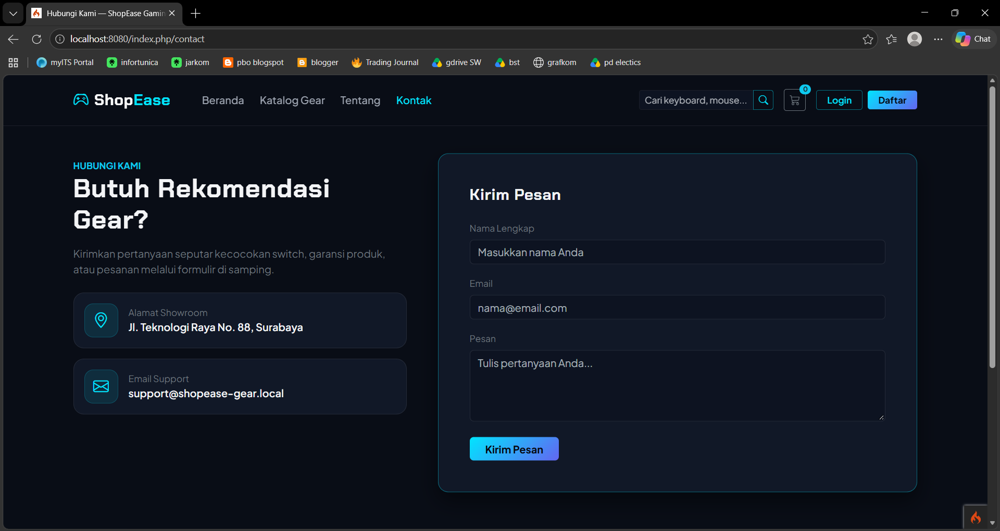

# PBKK Pertemuan 10 — ShopEase (Gaming Gear Online Store)

| Identitas | Keterangan |
| --- | --- |
| **Nama** | Rennard Filbert Tanjaya |
| **NRP** | 5025241122 |
| **Mata Kuliah** | Pemrograman Berbasis Kerangka Kerja (PBKK) |
| **Kelas** | D |
| **Proyek** | ShopEase — Gaming Gear & Desk Setup Store |
| **Framework** | CodeIgniter 4.7.6 (PHP 8.2+ & Bootstrap 5.3) |

---

## Ringkasan Proyek

**ShopEase** adalah aplikasi toko online berbasis web yang dikembangkan secara bertahap menggunakan **CodeIgniter 4**. Pada **Pertemuan 10 (Tahap 1)**, fokus pengembangan mencakup arsitektur **Routing, Controller, View Layouts**, serta perancangan antarmuka (*frontend*) bertema **Gaming Gear & Desk Setup** tanpa koneksi database terlebih dahulu.

Data kategori dan **8 produk gaming gear asli** disiapkan dalam library PHP terpisah (`App\Libraries\DummyCatalog`) dengan dukungan pembacaan aset gambar lokal otomatis dari folder `public/uploads/products/` (beserta fallback placeholder), sehingga struktur datanya siap dimigrasikan ke Model MySQL pada tahap selanjutnya.

| Halaman | URL | Controller & Method | Fitur Utama |
| --- | --- | --- | --- |
| **Beranda** | `/` | `HomeController::index` | Hero banner, statistik toko, 4 kategori gear, produk unggulan, & rilis terbaru |
| **Katalog Gear** | `/catalog` | `ProductController::catalog` | Daftar 8 produk, pencarian kata kunci, filter kategori, & urutkan harga |
| **Detail Produk** | `/product/{id}` | `ProductController::detail` | Galeri multi-gambar interaktif, spesifikasi teknis, status stok, & produk terkait |
| **Tentang Kami** | `/about` | `HomeController::about` | Profil toko, kurasi produk, dan transparansi transaksi |
| **Kontak** | `/contact` | `HomeController::contact` | Informasi showroom/support dan simulasi formulir pesan |

---

## Daftar Isi

1. [Konsep Toko dan Alur MVC](#1-konsep-toko-dan-alur-mvc)
2. [Lingkungan Pengembangan](#2-lingkungan-pengembangan)
3. [Implementasi Routing, Controller, Data Dummy, dan View](#3-implementasi-routing-controller-data-dummy-dan-view)
4. [Katalog Produk Dummy (Gaming Gear)](#4-katalog-produk-dummy-gaming-gear)
5. [Desain Antarmuka dan Palet Warna](#5-desain-antarmuka-dan-palet-warna)
6. [Langkah Instalasi dan Menjalankan Aplikasi](#6-langkah-instalasi-dan-menjalankan-aplikasi)
7. [Dokumentasi Tampilan (Screenshot)](#7-dokumentasi-tampilan-screenshot)
8. [Struktur Folder Proyek](#8-struktur-folder-proyek)

---

## 1. Konsep Toko dan Alur MVC

### Alasan Pemilihan Konsep Gaming Gear
Konsep **Gaming Gear & Desk Setup** dipilih karena selaras dengan spesifikasi PRD ShopEase: produk fisik berbasis SKU tunggal (tidak membutuhkan matriks varian ukuran kompleks seperti pakaian), memiliki spesifikasi teknis yang kaya untuk halaman detail, cocok untuk galeri multi-foto (`product_images`), serta relevan untuk alur pembayaran dan pengiriman berbasis kurir/resi di tahap lanjutan.

### Alur Permintaan (Request Lifecycle)

Pada tahap ini, alur MVC dipisahkan dengan jelas antara pemetaan URL, pengolahan logika di controller, sumber data sementara, dan rendering tampilan berbasis layout bersama:



---

## 2. Lingkungan Pengembangan

| Komponen | Spesifikasi / Versi |
| --- | --- |
| **Sistem Operasi** | Windows 11 |
| **PHP** | PHP 8.2+ (ekstensi `intl` dan `mbstring` aktif) |
| **Framework** | CodeIgniter `4.7.6` (`codeigniter4/appstarter`) |
| **Package Manager** | Composer |
| **Code Editor** | Visual Studio Code + ekstensi PHP Intelephense |
| **Frontend & UI** | Bootstrap 5.3.3, Bootstrap Icons 1.11.3, Google Fonts (*Chakra Petch* & *Plus Jakarta Sans*), & Custom CSS (`style.css`) |

---

## 3. Implementasi Routing, Controller, Data Dummy, dan View

### 3.1 Konfigurasi Helper (`app/Controllers/BaseController.php`)
Helper `form` dan `url` diaktifkan di dalam `initController()` agar fungsi `site_url()`, `base_url()`, dan helper form tersedia di seluruh controller dan view:

```php
public function initController(RequestInterface $request, ResponseInterface $response, LoggerInterface $logger)
{
    $this->helpers = ['form', 'url'];

    parent::initController($request, $response, $logger);
}
```

### 3.2 Routing (`app/Config/Routes.php`)
Seluruh halaman didaftarkan secara eksplisit menggunakan format routing standar CodeIgniter 4:

```php
$routes->get('/', 'HomeController::index');
$routes->get('about', 'HomeController::about');
$routes->get('contact', 'HomeController::contact');

$routes->get('catalog', 'ProductController::catalog');
$routes->get('product/(:num)', 'ProductController::detail/$1');
```

| Method | Endpoint | Handler | Deskripsi |
| --- | --- | --- | --- |
| `GET` | `/` | `HomeController::index` | Menampilkan halaman beranda |
| `GET` | `/about` | `HomeController::about` | Menampilkan halaman tentang toko |
| `GET` | `/contact` | `HomeController::contact` | Menampilkan halaman kontak |
| `GET` | `/catalog` | `ProductController::catalog` | Katalog produk dengan query `q`, `category`, dan `sort` |
| `GET` | `/product/(:num)` | `ProductController::detail/$1` | Detail produk berdasarkan ID (mengembalikan `404` jika tidak ditemukan) |

### 3.3 Pencarian, Filter, dan Pengurutan (`app/Controllers/ProductController.php`)
Meskipun belum terhubung ke database, fitur pencarian kata kunci, filter kategori, serta pengurutan harga terendah/tertinggi sudah berfungsi penuh melalui parameter `GET` di URL (`/catalog?q=...&category=...&sort=...`):

```php
$keyword      = trim((string) $this->request->getGet('q'));
$selectedCat  = trim((string) $this->request->getGet('category'));
$selectedSort = trim((string) $this->request->getGet('sort'));

if ($selectedCat !== '') {
    $products = array_filter($products, function ($item) use ($selectedCat) {
        return $item['category_slug'] === $selectedCat;
    });
}

if ($keyword !== '') {
    $products = array_filter($products, function ($item) use ($keyword) {
        return stripos($item['name'], $keyword) !== false
            || stripos($item['description'], $keyword) !== false
            || stripos($item['category_name'], $keyword) !== false;
    });
}
```

### 3.4 Master Layout & Keamanan Output (`app/Views/layouts/main.php`)
Seluruh view halaman (`home`, `catalog`, `detail`, `about`, `contact`) mewarisi layout utama menggunakan `$this->extend('layouts/main')` dan `$this->section('content')`.
* Seluruh data dinamis di view di-escape menggunakan fungsi `esc()` untuk mencegah XSS.
* Tombol **Login**, **Daftar**, dan **Keranjang** di navbar serta tombol **Tambah ke Keranjang** pada detail produk dihubungkan ke modal informasi (`#comingSoonModal`) agar tidak memicu error `404` selama tahap Week 10.

---

## 4. Katalog Produk Dummy (Gaming Gear)

Data produk disimpan di `app/Libraries/DummyCatalog.php`, terdiri dari **4 kategori** dan **8 produk gaming gear** dengan format harga Rupiah (IDR), status stok, spesifikasi teknis, serta aset foto PNG transparan pada `public/uploads/products/`:

| ID | Nama Produk | Kategori | Harga (IDR) | Stok | Status / Badge | Nama File Aset (`public/uploads/products/`) |
| :---: | --- | --- | :---: | :---: | :---: | --- |
| 1 | **AULA F75 Tri-Mode Gasket** | Mechanical Keyboard | Rp 849.000 | 15 | Best Seller | `aula-f75.png` |
| 2 | **Pulsar Pro Series Susanto-X 2.0 Medium** *(Hero Featured)* | Gaming Mouse | Rp 2.750.000 | 10 | Pro Choice | `pulsar-susanto-x-2.png` |
| 3 | **HyperX Cloud III Wireless** | Audio & Headset | Rp 2.499.000 | 9 | New | `hyperx-cloud-3-wireless.png` |
| 4 | **Wooting 60HE+ Rapid Trigger** | Mechanical Keyboard | Rp 4.469.000 | 5 | Esports | `wooting-60he-plus.png` |
| 5 | **Artisan Ninja FX Zero Soft XL** | Desk & Accessories | Rp 1.347.000 | 14 | Popular | `artisan-fx-zero-xl.png` |
| 6 | **HyperX QuadCast S RGB USB** | Audio & Headset | Rp 2.550.000 | 12 | Streamer | `hyperx-quadcast-s.png` |
| 7 | **BenQ ScreenBar Pro LED** | Desk & Accessories | Rp 3.425.000 | 8 | Setup Essential | `benq-screenbar-pro.png` |
| 8 | **Logitech G PRO X SUPERLIGHT 2** | Gaming Mouse | Rp 2.358.000 | 0 | Stok Habis | `logitech-gpx-superlight-2.png` |

> **Catatan Galeri & Stok:** Produk dengan ID 8 (`Logitech G PRO X SUPERLIGHT 2`) sengaja disetel `stock = 0` untuk mendemonstrasikan badge *Stok Habis* dan penonaktifan tombol tambah keranjang.

---

## 5. Desain Antarmuka dan Palet Warna

Antarmuka mengusung gaya **Cyber-Minimalist Dark Mode** dengan efek *glassmorphism* pada navbar, efek *spotlight* radial lembut di belakang foto produk PNG transparan (`aspect-ratio: 4 / 3`, `object-fit: contain`, dan `drop-shadow`) agar perangkat gaming berwarna gelap tetap menonjol dan seragam di seluruh halaman.

| Elemen | Kode Warna / Font | Penggunaan |
| --- | --- | --- |
| **Background Utama** | `#090d16` (*Obsidian*) | Latar belakang utama halaman |
| **Surface / Card** | `#111827` (*Slate Dark*) | Kartu produk, kotak filter, dan panel spesifikasi |
| **Spotlight Produk** | `radial-gradient` putih lembut → `#0d1321` | Bingkai 4:3 foto PNG transparan pada kartu & halaman detail |
| **Aksen Utama** | `#00e5ff` (*Cyber Cyan*) | Highlight teks, harga, ikon kategori, dan border aktif |
| **Aksen Sekunder** | `#6366f1` (*Electric Indigo*) | Gradasi tombol utama (`btn-cyber`) dan glow hero |
| **Tipografi Heading** | *Chakra Petch* (Bold) | Brand logo, judul section, dan tag harga |
| **Tipografi Body** | *Plus Jakarta Sans* | Paragraf, deskripsi produk, formulir, dan navigasi |

---

## 6. Langkah Instalasi dan Menjalankan Aplikasi

### 6.1 Prasyarat
Pastikan **PHP 8.2+** (dengan ekstensi `intl` dan `mbstring` aktif) serta **Composer** sudah terpasang pada komputer.

### 6.2 Instalasi Dependensi & Konfigurasi `.env`
Masuk ke folder `shopease`, lalu instal dependensi Composer (jika folder `vendor/` belum tersedia) dan salin file `env` menjadi `.env`:

```powershell
cd shopease
composer install
Copy-Item env .env
```

Buka file `.env`, lalu hapus tanda `#` dan sesuaikan dua baris berikut:

```ini
CI_ENVIRONMENT = development
app.baseURL = 'http://localhost:8080/'
```

### 6.3 Menjalankan Server Lokal
Jalankan server bawaan CodeIgniter 4 dari dalam folder `shopease`:

```powershell
php spark serve
```

Buka browser dan akses:
* **Beranda:** `http://localhost:8080/`
* **Katalog:** `http://localhost:8080/catalog`
* **Detail Produk:** `http://localhost:8080/product/1`
* **Tentang Kami:** `http://localhost:8080/about`
* **Kontak:** `http://localhost:8080/contact`

Untuk memeriksa daftar route yang terdaftar, jalankan `php spark routes`.

---

## 7. Dokumentasi Tampilan (Screenshot)

* **Halaman Beranda (Hero, Kategori, & Produk Unggulan)**
  
  
  
  
  
* **Halaman Katalog (Pencarian, Filter Kategori, & Urut Harga)**
  
  
* **Halaman Detail Produk (Galeri Multi-Gambar & Spesifikasi)**
  
  
* **Halaman Tentang Kami**
  
* **Halaman Kontak**
  

---

## 8. Struktur Folder Proyek

```text
Latihan 6 - Week 10/
├── README.md
├── Documentation/
└── shopease/
    ├── app/
    │   ├── Config/
    │   │   └── Routes.php
    │   ├── Controllers/
    │   │   ├── BaseController.php
    │   │   ├── HomeController.php
    │   │   └── ProductController.php
    │   ├── Libraries/
    │   │   └── DummyCatalog.php
    │   └── Views/
    │       ├── layouts/
    │       │   └── main.php
    │       └── frontend/
    │           ├── home.php
    │           ├── catalog.php
    │           ├── detail.php
    │           ├── about.php
    │           └── contact.php
    ├── public/
    │   ├── assets/
    │   │   └── css/
    │   │       └── style.css
    │   └── uploads/
    │       └── products/
    ├── .env
    ├── composer.json
    └── spark
```