# PBKK Pertemuan 11 — ShopEase (Authentication System)

| Identitas | Keterangan |
| --- | --- |
| **Nama** | Rennard Filbert Tanjaya |
| **NRP** | 5025241122 |
| **Mata Kuliah** | Pemrograman Berbasis Kerangka Kerja (PBKK) |
| **Kelas** | D |
| **Proyek** | ShopEase — Gaming Gear & Desk Setup Store |
| **Framework** | CodeIgniter 4.7.6 (PHP 8.2+, MySQL / MySQLi, & Bootstrap 5.3) |

---

## Ringkasan Proyek

Proyek ini merupakan pengembangan lanjutan dari **ShopEase – Gaming Gear Online Store** (Pertemuan 10) dengan menambahkan modul **Authentication & Role-Based Authorization** menggunakan **CodeIgniter 4** dan database **MySQL (`db_shopease`)**.

Pada tahap ini, pengunjung dapat mendaftar akun baru sebagai `customer`, masuk menggunakan email dan kata sandi ter-hash, serta keluar dari sesi secara aman. Sistem juga menerapkan **Migration & Seeder** untuk menyiapkan skema tabel `users` beserta akun demo tiga peran (`admin`, `operator`, dan `customer`), serta **HTTP Filter (`AuthFilter`)** untuk melindungi halaman berdasarkan status login dan hak akses peran. Katalog produk *Gaming Gear* tetap menggunakan `DummyCatalog` dari Pertemuan 10 dan akan dimigrasikan ke database pada tahap berikutnya.

| Halaman / Endpoint | URL | Metode | Akses |
| --- | --- | :---: | --- |
| **Beranda, Katalog, Detail, About, Kontak** | `/`, `/catalog`, `/product/{id}`, `/about`, `/contact` | `GET` | Publik |
| **Registrasi Akun** | `/register` | `GET`, `POST` | Pengunjung (belum login) |
| **Login Pengguna** | `/login` | `GET`, `POST` | Pengunjung (belum login) |
| **Logout** | `/logout` | `POST` | Semua pengguna login |
| **Dashboard Admin** | `/admin` | `GET` | Khusus role `admin` |
| **Dashboard Operator** | `/operator` | `GET` | Khusus role `operator` |

---

## Daftar Isi

1. [Alur Autentikasi dan Otorisasi](#1-alur-autentikasi-dan-otorisasi)
2. [Lingkungan Pengembangan](#2-lingkungan-pengembangan)
3. [Database, Migration, dan Seeder](#3-database-migration-dan-seeder)
4. [Implementasi Routing, Model, Controller, Filter, dan View](#4-implementasi-routing-model-controller-filter-dan-view)
5. [Hak Akses Berdasarkan Role dan Keamanan](#5-hak-akses-berdasarkan-role-dan-keamanan)
6. [Langkah Instalasi dan Menjalankan Aplikasi](#6-langkah-instalasi-dan-menjalankan-aplikasi)
7. [Skenario Pengujian](#7-skenario-pengujian)
8. [Dokumentasi Tampilan (Screenshot)](#8-dokumentasi-tampilan-screenshot)
9. [Struktur Folder Proyek](#9-struktur-folder-proyek)

---

## 1. Alur Autentikasi dan Otorisasi

1. **Registrasi (`POST /register`):** Pengunjung mengisi formulir pendaftaran. `AuthController::store()` memvalidasi nama, keunikan email, panjang password minimal 8 karakter, serta kesamaan konfirmasi password. Password di-hash menggunakan `password_hash(..., PASSWORD_DEFAULT)` dan role ditetapkan secara otomatis sebagai `customer`.
2. **Login (`POST /login`):** `AuthController::authenticate()` menormalisasi email, mencari pengguna melalui `UserModel`, dan memverifikasi kecocokan hash menggunakan `password_verify()`. Jika valid, session ID diregenerasi (`session()->regenerate(true)`), identitas pengguna disimpan di session, lalu pengguna diarahkan sesuai perannya (`admin` → `/admin`, `operator` → `/operator`, `customer` → `/`).
3. **Proteksi Halaman (`AuthFilter`):** Setiap permintaan ke grup `/admin` atau `/operator` diperiksa oleh `AuthFilter::before()`. Pengunjung yang belum login diarahkan ke `/login`, sedangkan pengguna dengan role yang tidak berwenang ditolak dan diarahkan ke `/` beserta pesan flash error.
4. **Logout (`POST /logout`):** Sesi dihancurkan melalui `session()->destroy()` via permintaan `POST` yang dilindungi token CSRF, lalu diarahkan kembali ke `/login`.

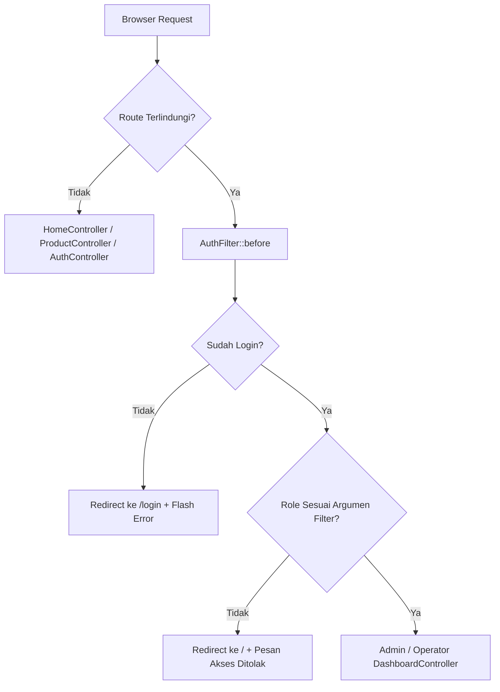

---

## 2. Lingkungan Pengembangan

| Komponen | Spesifikasi / Versi |
| --- | --- |
| **Sistem Operasi** | Windows 11 |
| **Server Lokal & Database** | XAMPP (MySQL / MariaDB port `3306`, driver `MySQLi`) |
| **PHP** | PHP 8.2+ (ekstensi `intl`, `mbstring`, `mysqli` aktif) |
| **Framework** | CodeIgniter `4.7.6` (`codeigniter4/appstarter`) |
| **Package Manager** | Composer |
| **Code Editor** | Visual Studio Code + ekstensi PHP Intelephense |
| **Frontend & UI** | Bootstrap 5.3.3, Bootstrap Icons 1.11.3, Google Fonts (*Chakra Petch* & *Plus Jakarta Sans*), & Custom CSS (`style.css`) |

---

## 3. Database, Migration, dan Seeder

### 3.1 Struktur Tabel `users` (`db_shopease`)

Tabel dibuat menggunakan **CodeIgniter Migration** (`app/Database/Migrations/*_CreateUsersTable.php`) agar skema mudah direproduksi ulang:

| Kolom | Tipe Data | Constraint / Keterangan |
| --- | --- | --- |
| `id_user` | `INT(11) UNSIGNED` | Primary Key, `AUTO_INCREMENT` |
| `name` | `VARCHAR(100)` | `NOT NULL` — Nama lengkap pengguna |
| `email` | `VARCHAR(100)` | `NOT NULL`, `UNIQUE` — Email login |
| `password` | `VARCHAR(255)` | `NOT NULL` — Hash password (`PASSWORD_DEFAULT`) |
| `role` | `ENUM('customer','admin','operator')` | `NOT NULL`, default `'customer'` |
| `phone` | `VARCHAR(20)` | `NULL` — Nomor telepon (opsional) |
| `address` | `TEXT` | `NULL` — Alamat pengiriman (opsional) |
| `created_at` | `DATETIME` | `NULL` — Waktu registrasi (otomatis oleh CI4) |
| `updated_at` | `DATETIME` | `NULL` — Waktu pembaruan terakhir |

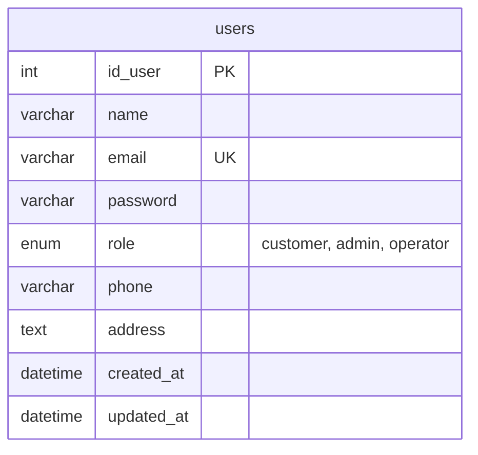

### 3.2 Daftar Akun Demo Hasil Seeder (`UserSeeder.php`)

Formulir registrasi publik tidak menyediakan pilihan role `admin` atau `operator`. Akun dengan hak istimewa disiapkan melalui `UserSeeder` yang dipanggil oleh `DatabaseSeeder` (dilengkapi pengecekan email agar aman dijalankan berulang kali tanpa duplikasi):

| Role | Nama | Email | Password | Alamat | Tujuan Redirect |
| --- | --- | --- | --- | --- | --- |
| **Admin** | Admin ShopEase | `admin@shopease.com` | `admin1234` | Jl. Ikan Hiu No. 88, Surabaya | `/admin` |
| **Operator** | Operator Gudang | `operator@shopease.com` | `operator1234` | Gudang ShopEase, Surabaya | `/operator` |
| **Customer 1** | Rennard Filbert | `rennard@shopease.com` | `customer1234` | Sukolilo, Surabaya, Jawa Timur | `/` |
| **Customer 2** | Willy Marcelius | `willy@shopease.com` | `customer1234` | Gubeng, Surabaya, Jawa Timur | `/` |

---

## 4. Implementasi Routing, Model, Controller, Filter, dan View

### 4.1 Routing (`app/Config/Routes.php`)

```php
// Frontend Publik (Week 10)
$routes->get('/', 'HomeController::index');
$routes->get('about', 'HomeController::about');
$routes->get('contact', 'HomeController::contact');
$routes->get('catalog', 'ProductController::catalog');
$routes->get('product/(:num)', 'ProductController::detail/$1');

// Authentication (Week 11)
$routes->get('register', 'AuthController::register');
$routes->post('register', 'AuthController::store');
$routes->get('login', 'AuthController::login');
$routes->post('login', 'AuthController::authenticate');
$routes->post('logout', 'AuthController::logout');

// Halaman Terlindungi Role (AuthFilter)
$routes->group('admin', ['filter' => 'auth:admin'], static function ($routes) {
    $routes->get('/', 'Admin\DashboardController::index');
});

$routes->group('operator', ['filter' => 'auth:operator'], static function ($routes) {
    $routes->get('/', 'Operator\DashboardController::index');
});
```

### 4.2 UserModel (`app/Models/UserModel.php`)

Mengelola akses ke tabel `users` dengan primary key `id_user`, daftar kolom yang diizinkan (`$allowedFields`), dan pengelolaan otomatis `created_at` serta `updated_at`:

```php
class UserModel extends Model
{
    protected $table            = 'users';
    protected $primaryKey       = 'id_user';
    protected $useAutoIncrement = true;
    protected $returnType       = 'array';

    protected $allowedFields = [
        'name', 'email', 'password', 'role', 'phone', 'address',
    ];

    protected $useTimestamps = true;
    protected $dateFormat    = 'datetime';
    protected $createdField  = 'created_at';
    protected $updatedField  = 'updated_at';
}
```

### 4.3 Autentikasi & Regenerasi Session (`app/Controllers/AuthController.php`)

Proses login memverifikasi hash password, meregenerasi ID session untuk mencegah *session fixation*, lalu menyimpan identitas pengguna ke dalam session:

```php
$user = $this->userModel->where('email', $email)->first();

if (!$user || !password_verify($password, $user['password'])) {
    return redirect()->back()
        ->withInput()
        ->with('error', 'Email atau password salah.');
}

session()->regenerate(true);

session()->set([
    'isLoggedIn' => true,
    'user_id'    => $user['id_user'],
    'name'       => $user['name'],
    'email'      => $user['email'],
    'role'       => $user['role'],
]);

return $this->redirectByRole($user['role'])
    ->with('success', 'Selamat datang kembali, ' . $user['name'] . '!');
```

### 4.4 AuthFilter & CSRF Protection (`app/Filters/AuthFilter.php` & `app/Config/Filters.php`)

Alias `'auth' => \App\Filters\AuthFilter::class` dan filter global `'csrf'` diaktifkan pada `app/Config/Filters.php`. `AuthFilter` memeriksa status login sekaligus kecocokan role:

```php
public function before(RequestInterface $request, $arguments = null)
{
    $session = session();

    if (!$session->get('isLoggedIn')) {
        return redirect()->to('/login')
            ->with('error', 'Silakan login terlebih dahulu.');
    }

    if (!empty($arguments) && !in_array($session->get('role'), $arguments, true)) {
        return redirect()->to('/')
            ->with('error', 'Akses ditolak. Anda tidak memiliki izin membuka halaman tersebut.');
    }
}
```

### 4.5 Pembaruan Antarmuka & Navbar Dinamis (`app/Views/`)

Seluruh halaman autentikasi (`auth/login.php`, `auth/register.php`) dan dashboard (`admin/dashboard.php`, `operator/dashboard.php`) mewarisi master layout `layouts/main.php` dengan tema *Cyber-Minimalist Dark Mode* (`#090d16`, `#111827`, aksen `#00e5ff` & `#6366f1`):
* Saat belum login, navbar menampilkan tombol **Login** (`/login`) dan **Daftar** (`/register`).
* Saat sudah login, tombol tersebut berganti menjadi **dropdown profil pengguna** yang menampilkan nama, label role, tautan menuju **Dashboard Admin** atau **Dashboard Operator** (khusus role terkait), serta tombol **Logout** berbasis form `POST` bertoken CSRF.
* Pesan flashdata (`success` dan `error`) ditampilkan otomatis di halaman tujuan maupun pada kotak validasi formulir.

---

## 5. Hak Akses Berdasarkan Role dan Keamanan

### Matriks Hak Akses

| Fitur / Halaman | Pengunjung | Customer | Operator | Admin |
| --- | :---: | :---: | :---: | :---: |
| Beranda, Katalog, Detail Produk, About, Kontak | Ya | Ya | Ya | Ya |
| Halaman `/login` dan `/register` | Ya | Redirect ke `/` | Redirect ke `/operator` | Redirect ke `/admin` |
| Logout (`POST /logout`) | Tidak | Ya | Ya | Ya |
| Dashboard Admin (`/admin`) + Statistik Akun | Tidak | Ditolak | Ditolak | Ya |
| Dashboard Operator (`/operator`) | Tidak | Ditolak | Ya | Ditolak |

### Praktik Keamanan yang Diterapkan

* **Password Hashing:** Kata sandi tidak pernah disimpan dalam bentuk teks biasa, melainkan menggunakan `password_hash()` dan diverifikasi dengan `password_verify()`.
* **CSRF Protection:** Filter CSRF aktif secara global dan seluruh form `POST` (Register, Login, Logout) menyertakan `<?= csrf_field() ?>`.
* **Session Security:** Menggunakan `session()->regenerate(true)` setelah autentikasi berhasil dan `session()->destroy()` saat logout.
* **Privilege Escalation Prevention:** Role pada registrasi publik di-hardcode menjadi `'customer'` di sisi server dan tidak menerima input role dari form.
* **Generic Error Message & Output Escaping:** Pesan gagal login tidak membocorkan apakah email terdaftar atau tidak (`Email atau password salah.`), dan seluruh output di View di-escape menggunakan `esc()`.

---

## 6. Langkah Instalasi dan Menjalankan Aplikasi

### 6.1 Prasyarat
1. Pastikan **XAMPP / Laragon** (layanan **MySQL** aktif), **PHP 8.2+** (ekstensi `intl`, `mbstring`, `mysqli`), dan **Composer** sudah terpasang.

### 6.2 Konfigurasi `.env` & Dependensi
Masuk ke folder `shopease`, instal dependensi Composer (jika folder `vendor/` belum tersedia), lalu salin `env` menjadi `.env`:

```powershell
cd shopease
composer install
Copy-Item env .env
```

Buka `.env`, hapus tanda `#`, dan sesuaikan pengaturan berikut:

```ini
CI_ENVIRONMENT = development
app.baseURL = 'http://localhost:8080/'

database.default.hostname = localhost
database.default.database = db_shopease
database.default.username = root
database.default.password =
database.default.DBDriver = MySQLi
database.default.port = 3306
```

### 6.3 Buat Database, Migration, & Seeder via Spark CLI
Jalankan perintah berikut secara berurutan dari terminal di dalam folder `shopease`:

```powershell
php spark db:create db_shopease
php spark migrate
php spark db:seed DatabaseSeeder
```

*(Jika ingin mereset tabel dan mengisi ulang data demo dari awal, jalankan `php spark migrate:refresh` lalu `php spark db:seed DatabaseSeeder`.)*

### 6.4 Menjalankan Server Lokal

```powershell
php spark serve
```

Buka `http://localhost:8080/` di browser. Untuk memverifikasi daftar route dan filter yang aktif, jalankan `php spark routes`.

---

## 7. Skenario Pengujian

| No. | Skenario Pengujian | Hasil yang Diharapkan | Status |
| :---: | --- | --- | :---: |
| 1 | Registrasi akun customer baru melalui `/register` | Akun tersimpan di `users` dengan password hash dan redirect ke `/login`. | Lulus |
| 2 | Registrasi menggunakan email yang sudah terdaftar | Ditolak dengan pesan *"Email sudah terdaftar."* | Lulus |
| 3 | Registrasi dengan password kurang dari 8 karakter | Ditolak dengan pesan *"Password minimal 8 karakter."* | Lulus |
| 4 | Registrasi dengan konfirmasi password tidak cocok | Ditolak dengan pesan *"Konfirmasi password tidak sama."* | Lulus |
| 5 | Login dengan akun `customer`, `admin`, dan `operator` yang valid | Session terbuat dan pengguna diarahkan otomatis ke `/`, `/admin`, atau `/operator`. | Lulus |
| 6 | Login menggunakan email atau password yang salah | Ditolak dengan pesan *"Email atau password salah."* | Lulus |
| 7 | Logout melalui dropdown navbar atau tombol di dashboard | Session berakhir (`session()->destroy()`) dan redirect ke `/login`. | Lulus |
| 8 | Akses `/admin` tanpa login, atau akses `/admin` menggunakan akun `customer` / `operator` | Tanpa login → redirect ke `/login`; role tidak sesuai → redirect ke `/` dengan pesan akses ditolak. | Lulus |

---

## 8. Dokumentasi Tampilan (Screenshot)

### Registrasi & Validasi
* **Halaman Registrasi (`/register`)**
  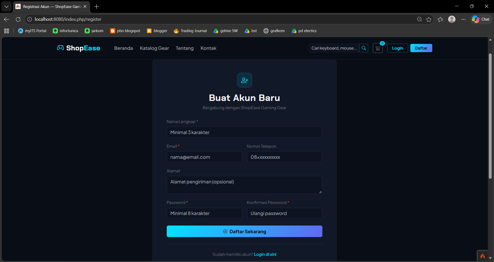
* **Validasi Registrasi (Email Duplikat / Password < 8 Karakter)**
  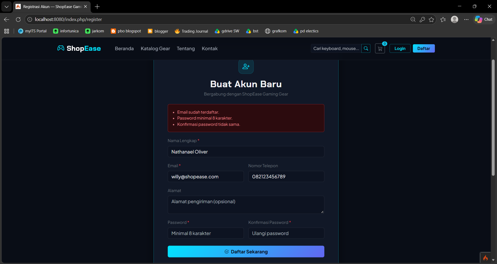
* **Registrasi Berhasil & Redirect ke Login**
  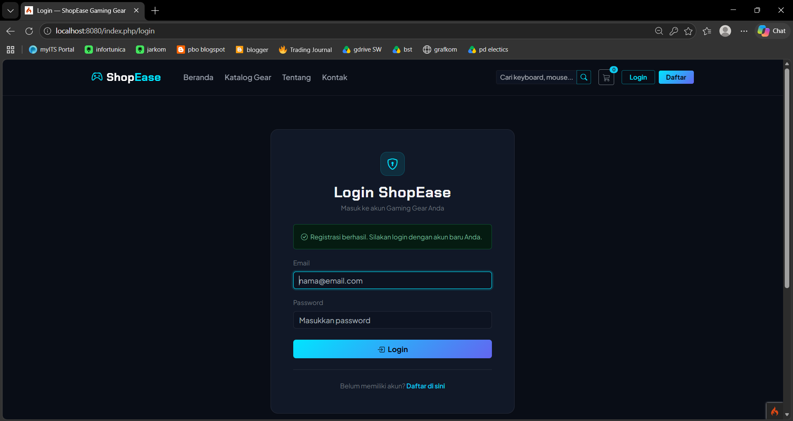

### Login, Session, & Logout
* **Halaman Login (`/login`)**
  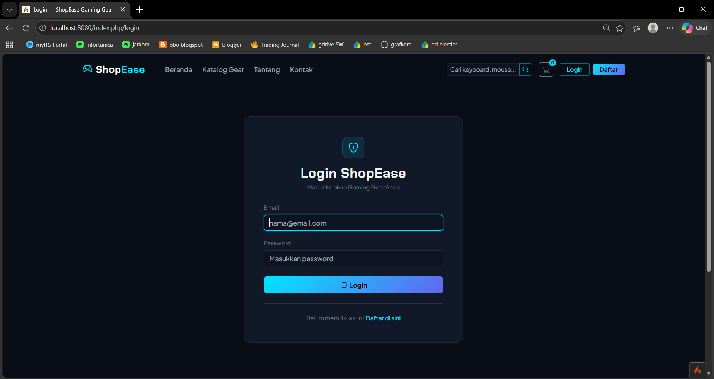
* **Login Gagal (Password Salah)**
  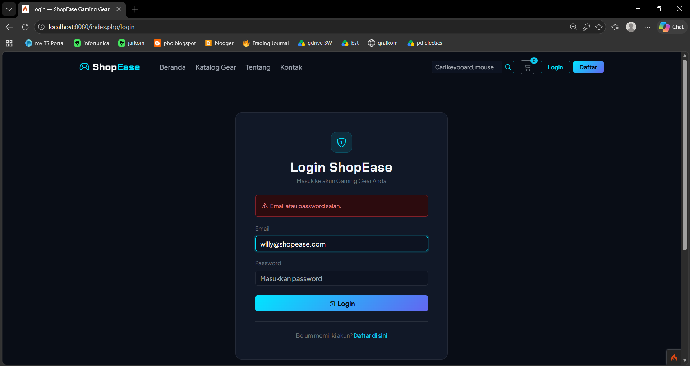
* **Beranda Setelah Login Customer (Dropdown Profil & Logout)**
  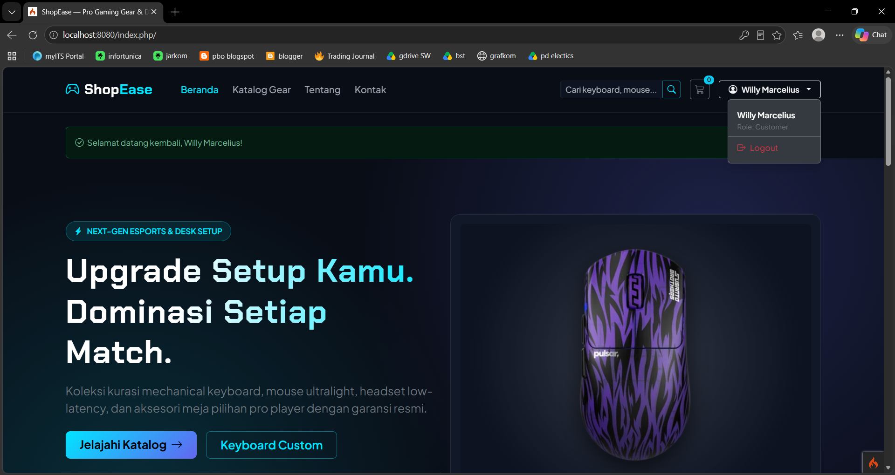
* **Konfirmasi Berhasil Logout**
  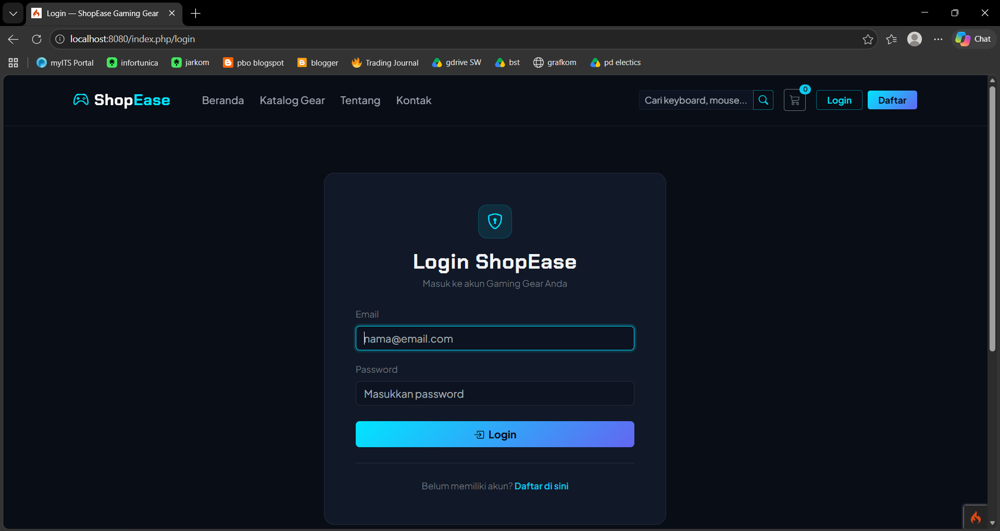

### Role-Based Access Control (`AuthFilter`)
* **Dashboard Admin (`/admin`)**
  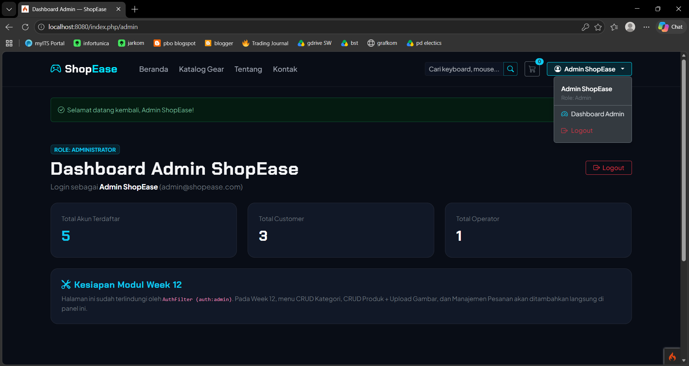
* **Dashboard Operator (`/operator`)**
  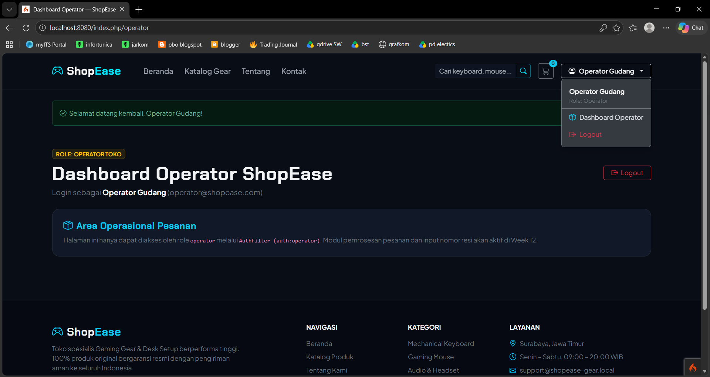
* **Pembatasan Akses oleh `AuthFilter` (Akses Tanpa Login / Role Tidak Sesuai)**
  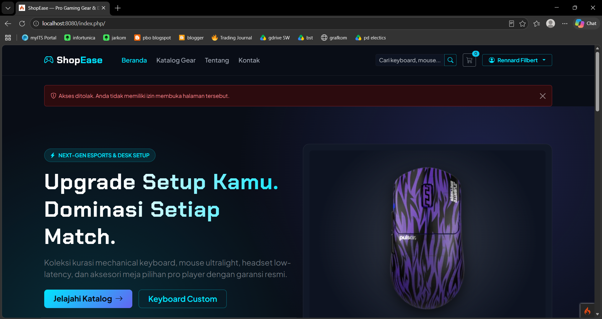

---

## 9. Struktur Folder Proyek

```text
Latihan 7 - Week 11/
├── README.md
├── Documentation/
└── shopease/
    ├── app/
    │   ├── Config/
    │   │   ├── Filters.php
    │   │   └── Routes.php
    │   ├── Controllers/
    │   │   ├── BaseController.php
    │   │   ├── HomeController.php
    │   │   ├── ProductController.php
    │   │   ├── AuthController.php
    │   │   ├── Admin/
    │   │   │   └── DashboardController.php
    │   │   └── Operator/
    │   │       └── DashboardController.php
    │   ├── Database/
    │   │   ├── Migrations/
    │   │   │   └── *_CreateUsersTable.php
    │   │   └── Seeds/
    │   │       ├── DatabaseSeeder.php
    │   │       └── UserSeeder.php
    │   ├── Filters/
    │   │   └── AuthFilter.php
    │   ├── Libraries/
    │   │   └── DummyCatalog.php
    │   ├── Models/
    │   │   └── UserModel.php
    │   └── Views/
    │       ├── layouts/
    │       │   └── main.php
    │       ├── auth/
    │       │   ├── login.php
    │       │   └── register.php
    │       ├── admin/
    │       │   └── dashboard.php
    │       ├── operator/
    │       │   └── dashboard.php
    │       └── frontend/
    │           ├── home.php
    │           ├── catalog.php
    │           ├── detail.php
    │           ├── about.php
    │           └── contact.php
    ├── public/
    │   ├── assets/
    │   │   └── css/
    │   │       └── style.css
    │   └── uploads/
    │       └── products/
    ├── .env
    ├── composer.json
    └── spark
```

---