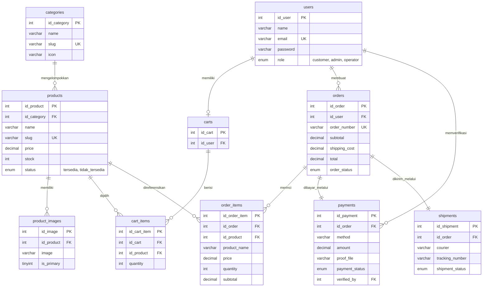
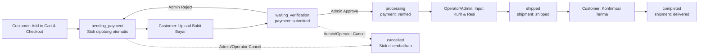
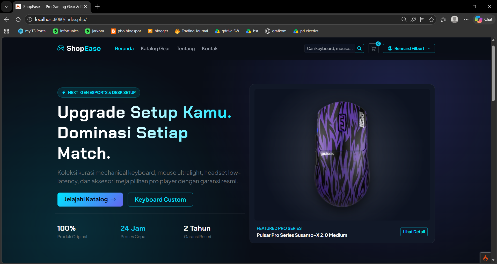

# PBKK Pertemuan 12 — ShopEase (Full-Stack Gaming Gear E-Commerce)

| Identitas | Keterangan |
| --- | --- |
| **Nama** | Rennard Filbert Tanjaya |
| **NRP** | 5025241122 |
| **Mata Kuliah** | Pemrograman Berbasis Kerangka Kerja (PBKK) |
| **Kelas** | D |
| **Proyek** | ShopEase — Gaming Gear & Desk Setup Store |
| **Framework** | CodeIgniter 4.7.6 (PHP 8.2+, MySQL / MySQLi, Bootstrap 5.3, & Chart.js 4.4) |

---

## Ringkasan Proyek

Proyek ini merupakan tahap final dari pengembangan aplikasi **ShopEase — Gaming Gear Online Store** yang melanjutkan fondasi tampilan **Week 10** dan sistem autentikasi **Week 11**. Pada **Pertemuan 12**, seluruh katalog produk dimigrasikan penuh dari data dummy ke database relasional **MySQL (`db_shopease`)** serta dilengkapi siklus transaksi e-commerce menyeluruh (*end-to-end*).

Fitur utama yang dibangun mencakup **Manajemen Kategori & Produk (CRUD + Multi-Upload Gambar)**, **Shopping Cart real-time**, **Checkout Transaksional** (validasi ulang stok, kalkulasi total server-side, snapshot harga, dan pemotongan stok otomatis), **Upload & Verifikasi Bukti Pembayaran**, **Pengelolaan Pengiriman & Nomor Resi**, serta **Dashboard Statistik Admin & Operator dengan Grafik Penjualan (Chart.js)**.

| Modul Utama | URL Utama | Role yang Diizinkan | Fitur Kunci |
| --- | --- | --- | --- |
| **Storefront & Katalog MySQL** | `/`, `/catalog`, `/product/{id}` | Publik | 10 produk asli dari MySQL, pencarian, filter kategori, urut harga, pagination, & galeri multi-foto |
| **Shopping Cart & Checkout** | `/cart`, `/checkout` | Semua user login | Tambah/ubah/hapus item, badge keranjang real-time, pilihan ongkir, & checkout transaksional |
| **Pesanan & Pembayaran Customer** | `/orders`, `/orders/{id}` | Semua user login | Isolasi data pesanan per akun, upload bukti bayar, pantau resi, & konfirmasi selesai |
| **CRUD Kategori & Produk** | `/admin/categories`, `/admin/products` | `admin`, `operator` | CRUD lengkap, proteksi relasi kategori, multi-upload foto, pilih foto utama, & atur status/stok |
| **Order, Verifikasi, & Pengiriman** | `/admin/orders`, `/admin/orders/{id}` | `admin` (verifikasi & kirim), `operator` (kirim) | Approve/Reject pembayaran, input kurir & resi, serta pembatalan pesanan dengan restock otomatis |
| **Dashboard Analitik & Operasional** | `/admin`, `/operator` | `admin` / `operator` | 6 kartu statistik, grafik penjualan harian (Chart.js), peringatan stok menipis, & antrean resi |

---

## Daftar Isi

1. [Arsitektur Database & ERD (10 Tabel)](#1-arsitektur-database--erd-10-tabel)
2. [Alur Siklus Transaksi End-to-End](#2-alur-siklus-transaksi-end-to-end)
3. [Lingkungan Pengembangan](#3-lingkungan-pengembangan)
4. [Katalog 10 Produk Gaming Gear & Akun Demo](#4-katalog-10-produk-gaming-gear--akun-demo)
5. [Implementasi Modul & Daftar Route](#5-implementasi-modul--daftar-route)
6. [Hak Akses (RBAC) & Keamanan Transaksi](#6-hak-akses-rbac--keamanan-transaksi)
7. [Langkah Instalasi dan Menjalankan Aplikasi](#7-langkah-instalasi-dan-menjalankan-aplikasi)
8. [Skenario Pengujian End-to-End & Negative Testing](#8-skenario-pengujian-end-to-end--negative-testing)
9. [Dokumentasi Tampilan (Screenshot)](#9-dokumentasi-tampilan-screenshot)
10. [Struktur Folder Proyek](#10-struktur-folder-proyek)

---

## 1. Arsitektur Database & ERD (10 Tabel)

Seluruh skema database `db_shopease` dikelola melalui **CodeIgniter Migrations** (`CreateUsersTable` dan `CreateEcommerceTables`) sehingga mudah direproduksi ulang dari terminal.



---

## 2. Alur Siklus Transaksi End-to-End

Status pesanan dan pembayaran saling tersinkronisasi dari proses checkout hingga barang diterima oleh pelanggan:



---

## 3. Lingkungan Pengembangan

| Komponen | Spesifikasi / Versi |
| --- | --- |
| **Sistem Operasi** | Windows 11 |
| **Server Lokal & Database** | XAMPP (MySQL / MariaDB port `3306`, driver `MySQLi`) |
| **PHP** | PHP 8.2+ (ekstensi `intl`, `mbstring`, `mysqli` aktif) |
| **Framework** | CodeIgniter `4.7.6` (`codeigniter4/appstarter`) |
| **Package Manager** | Composer |
| **Frontend & Visualisasi** | Bootstrap 5.3.3, Bootstrap Icons 1.11.3, Chart.js 4.4.4, Google Fonts (*Chakra Petch* & *Plus Jakarta Sans*), Custom CSS (`style.css`) |

---

## 4. Katalog 10 Produk Gaming Gear & Akun Demo

### 4.1 Daftar 10 Produk (`CategorySeeder` & `ProductSeeder`)

Seluruh 4 kategori dan 10 produk gaming gear beserta foto PNG transparannya di `public/uploads/products/` dimigrasikan ke tabel `categories`, `products`, dan `product_images`:

| ID | Nama Produk | Kategori | Harga (IDR) | Stok Awal | Badge / Status |
| :---: | --- | --- | :---: | :---: | --- |
| 1 | **AULA F75 Tri-Mode Gasket** | Mechanical Keyboard | Rp 849.000 | 15 | Best Seller (`tersedia`) |
| 2 | **Pulsar Pro Series Susanto-X 2.0 Medium** *(Hero Featured)* | Gaming Mouse | Rp 2.750.000 | 10 | Pro Choice (`tersedia`) |
| 3 | **HyperX Cloud III Wireless** | Audio & Headset | Rp 2.499.000 | 9 | New (`tersedia`) |
| 4 | **Wooting 60HE+ Rapid Trigger** | Mechanical Keyboard | Rp 4.469.000 | 5 | Esports (`tersedia`) |
| 5 | **Artisan Ninja FX Zero Soft XL** | Desk & Accessories | Rp 1.347.000 | 14 | Popular (`tersedia`) |
| 6 | **HyperX QuadCast S RGB USB** | Audio & Headset | Rp 2.550.000 | 12 | Streamer (`tersedia`) |
| 7 | **BenQ ScreenBar Pro LED** | Desk & Accessories | Rp 3.425.000 | 8 | Setup Essential (`tersedia`) |
| 8 | **Logitech G PRO X SUPERLIGHT 2** | Gaming Mouse | Rp 2.358.000 | 0 | Stok Habis (`tersedia`, tombol beli nonaktif) |
| 9 | **Elgato Stream Deck MK.2** | Desk & Accessories | Rp 2.499.000 | 7 | Creator Pick (`tersedia`) |
| 10 | **Razer Viper V3 Pro Wireless** | Gaming Mouse | Rp 2.599.000 | 11 | Pro Flagship (`tersedia`) |

> **Catatan Stok:** Produk ID 8 sengaja berstatus `tersedia` dengan stok `0` untuk mendemonstrasikan kondisi *Stok Habis* di etalase tanpa menyembunyikan informasi produk.

### 4.2 Akun Demo (`UserSeeder`)

| Role | Nama | Email | Password | Dashboard / Tujuan |
| --- | --- | --- | --- | --- |
| **Admin** | Admin ShopEase | `admin@shopease.com` | `admin1234` | `/admin` |
| **Operator** | Operator Gudang | `operator@shopease.com` | `operator1234` | `/operator` |
| **Customer 1** | Rennard Filbert | `rennard@shopease.com` | `customer1234` | `/` |
| **Customer 2** | Willy Marcelius | `willy@shopease.com` | `customer1234` | `/` |

---

## 5. Implementasi Modul & Daftar Route

### 5.1 Daftar Route Lengkap (`app/Config/Routes.php`)

| Grup / Akses | Method & Endpoint | Handler | Fungsi |
| --- | --- | --- | --- |
| **Publik** | `GET /`, `/about`, `/contact`, `/catalog`, `/product/(:num)` | `HomeController`, `ProductController` | Storefront berbasis MySQL (pencarian, filter, sort, pagination, galeri) |
| **Autentikasi** | `GET/POST /register`, `GET/POST /login`, `POST /logout` | `AuthController` | Registrasi customer, login dengan hash & session regeneration, logout CSRF |
| **Customer (`auth`)** | `GET /cart`, `POST /cart/add`, `/cart/update/(:num)`, `/cart/remove/(:num)` | `CartController` | Manajemen keranjang belanja dan validasi stok |
| **Customer (`auth`)** | `GET /checkout`, `POST /checkout/process` | `CheckoutController` | Form pengiriman & proses checkout transaksional |
| **Customer (`auth`)** | `GET /orders`, `/orders/(:num)`, `POST /orders/(:num)/payment`, `/orders/(:num)/complete` | `OrderController` | Riwayat pesanan, upload bukti transfer, & konfirmasi penerimaan |
| **Khusus Admin (`auth:admin`)** | `GET /admin`, `POST /admin/orders/(:num)/verify-payment` | `Admin\DashboardController`, `Admin\OrderController` | Dashboard analitik Chart.js & Approve/Reject bukti pembayaran |
| **Khusus Operator (`auth:operator`)** | `GET /operator` | `Operator\DashboardController` | Dashboard antrean pengiriman & stok menipis |
| **Admin & Operator (`auth:admin,operator`)** | `GET/POST /admin/categories/*`, `/admin/products/*` | `Admin\CategoryController`, `Admin\ProductController` | CRUD Kategori, CRUD Produk, & manajemen multi-gambar produk |
| **Admin & Operator (`auth:admin,operator`)** | `GET /admin/orders`, `/admin/orders/(:num)`, `POST .../shipment`, `POST .../cancel` | `Admin\OrderController` | Kelola daftar pesanan, input kurir/resi, & pembatalan dengan restock |

### 5.2 Checkout Transaksional & Snapshot Harga (`app/Controllers/CheckoutController.php`)

Seluruh perhitungan harga dan ongkir dilakukan di server berdasarkan data terbaru dari MySQL, bukan dari input browser, serta dibungkus *database transaction* agar stok tidak pernah berkurang secara parsial jika terjadi kegagalan:

```php
$db = \Config\Database::connect();
$db->transBegin();

try {
    // 1. Validasi ulang status & stok produk dari database
    // 2. Simpan header pesanan ke tabel orders
    // 3. Simpan snapshot nama & harga ke order_items + potong stok di products
    // 4. Buat record awal di payments (unpaid) & shipments (pending)
    // 5. Kosongkan cart_items milik customer

    if ($db->transStatus() === false) {
        throw new \RuntimeException('Transaksi database gagal disimpan.');
    }

    $db->transCommit();
} catch (\Throwable $e) {
    $db->transRollback();
    return redirect()->to('/cart')->with('error', $e->getMessage());
}
```

### 5.3 Manajemen Multi-Gambar & Proteksi Penghapusan File (`app/Controllers/Admin/ProductController.php`)

Setiap unggahan foto produk (`images[]`) divalidasi MIME (`image/jpeg`, `image/png`, `image/webp`) serta ukuran maksimal 2 MB, diberi nama acak (`getRandomName()`), dan dicatat di tabel `product_images`. Saat foto atau produk dihapus, controller mengecek apakah file fisik masih dirujuk baris lain sebelum menjalankan `unlink()`, serta otomatis menaikkan foto tersisa menjadi `is_primary = 1`.

### 5.4 Analitik Penjualan & Grafik Harian (`app/Controllers/Admin/DashboardController.php`)

Dashboard Admin menghitung total pendapatan dari pesanan yang telah terbayar (`processing`, `shipped`, `completed`) dan menyajikannya dalam grafik batang harian menggunakan **Chart.js**, berdampingan dengan daftar produk berstok menipis (`stock <= 5`) dan pesanan terbaru.

---

## 6. Hak Akses (RBAC) & Keamanan Transaksi

### Matriks Hak Akses

| Fitur / Modul | Pengunjung | Customer | Operator | Admin |
| --- | :---: | :---: | :---: | :---: |
| Katalog, Pencarian, Filter, Detail Produk | Ya | Ya | Ya | Ya |
| Keranjang Belanja, Checkout, & Pesanan Saya | Tidak | Ya | Ya | Ya |
| CRUD Kategori & Produk + Upload Gambar | Tidak | Tidak | Ya | Ya |
| Input Kurir, Nomor Resi, & Update Pengiriman | Tidak | Tidak | Ya | Ya |
| Verifikasi Pembayaran (Approve / Reject) | Tidak | Tidak | Tidak | Ya |
| Dashboard Analitik & Grafik Penjualan | Tidak | Tidak | Tidak | Ya |
| Dashboard Operasional & Antrean Resi | Tidak | Tidak | Ya | Tidak |

### Praktik Keamanan yang Diterapkan

* **Proteksi CSRF & Output Escaping:** Filter `'csrf'` aktif secara global untuk seluruh request `POST` (form login, register, logout, CRUD, cart, checkout, upload bukti bayar, verifikasi, dan resi), serta seluruh tampilan memakai `esc()`.
* **Server-Side Price & Shipping Calculation:** Ongkos kirim (`Reguler` Rp 25.000 / `Express` Rp 50.000) dan harga produk diambil ulang di server saat checkout.
* **Isolasi Kepemilikan Pesanan:** `OrderController` selalu memfilter query dengan `where('id_user', session()->get('user_id'))` sehingga customer tidak bisa membuka atau mengunggah bukti untuk pesanan milik akun lain.
* **Validasi Upload Ketat:** Baik foto produk maupun bukti pembayaran memvalidasi tipe MIME asli file dan batas ukuran maksimal 2 MB.
* **Restock Transaksional Tanpa Hapus Histori:** Pembatalan pesanan mengubah status menjadi `cancelled` dan mengembalikan stok produk ke tabel `products` dalam satu transaksi database.

---

## 7. Langkah Instalasi dan Menjalankan Aplikasi

### 7.1 Prasyarat

Pastikan **XAMPP / Laragon** (layanan **MySQL** menyala), **PHP 8.2+** (ekstensi `intl`, `mbstring`, `mysqli`), dan **Composer** sudah terpasang.

### 7.2 Instalasi Dependensi & Konfigurasi `.env`

```powershell
cd shopease
composer install
Copy-Item env .env
```

Buka `.env`, hapus tanda `#`, dan sesuaikan pengaturan berikut:

```ini
CI_ENVIRONMENT = development
app.baseURL = 'http://localhost:8080/'

database.default.hostname = localhost
database.default.database = db_shopease
database.default.username = root
database.default.password =
database.default.DBDriver = MySQLi
database.default.port = 3306
```

### 7.3 Buat Database, Migration, & Seeder

Jalankan perintah berikut secara berurutan di terminal dari dalam folder `shopease`:

```powershell
php spark db:create db_shopease
php spark migrate
php spark db:seed DatabaseSeeder
```

*(Untuk mereset seluruh tabel dan mengisi ulang data awal dari kondisi bersih, jalankan `php spark migrate:refresh` diikuti `php spark db:seed DatabaseSeeder`.)*

### 7.4 Menjalankan Server Lokal

```powershell
php spark serve
```

Akses aplikasi melalui `http://localhost:8080/`. Untuk memeriksa seluruh route dan filter yang aktif, jalankan `php spark routes`.

---

## 8. Skenario Pengujian End-to-End & Negative Testing

| No. | Skenario Pengujian | Hasil yang Diharapkan | Status |
| :---: | --- | --- | :---: |
| 1 | Katalog MySQL (pencarian, filter kategori, urut harga, & pagination halaman 1–2) | 10 produk gaming gear tampil lengkap dengan foto lokal dan pagination berjalan lancar. | Lulus |
| 2 | CRUD Kategori & proteksi hapus kategori yang masih memiliki produk | Tambah/edit berhasil; hapus kategori berproduk ditolak dengan pesan error. | Lulus |
| 3 | CRUD Produk, multi-upload foto, ubah foto utama, & toggle status `tidak_tersedia` | Foto tersimpan di `product_images`; produk `tidak_tersedia` hilang dari katalog publik. | Lulus |
| 4 | Shopping Cart (tambah, ubah kuantitas, validasi melebihi stok, & hapus item) | Badge navbar sinkron, subtotal akurat, dan pembelian melebihi stok ditolak. | Lulus |
| 5 | Checkout transaksional & verifikasi pengurangan stok | Pesanan `SE-...` terbentuk, keranjang kosong, stok produk berkurang, dan harga tersimpan sebagai snapshot. | Lulus |
| 6 | Upload bukti pembayaran oleh Customer (validasi gambar <= 2 MB) | File tersimpan di `public/uploads/payments/`, status menjadi `waiting_verification`. | Lulus |
| 7 | Verifikasi pembayaran (Reject & Approve) khusus Admin | Reject mengembalikan ke `pending_payment`; Approve mengubah status ke `processing`; Operator tidak memiliki akses aksi ini. | Lulus |
| 8 | Input kurir & nomor resi oleh Operator/Admin lalu konfirmasi selesai oleh Customer | Nomor resi tampil di akun customer; konfirmasi terima mengubah status menjadi `completed` & `delivered`. | Lulus |
| 9 | Pembatalan pesanan oleh Admin/Operator | Status menjadi `cancelled` (histori tetap tersimpan) dan stok produk otomatis bertambah kembali. | Lulus |
| 10 | Isolasi akses & Dashboard Chart.js | Customer ditolak mengakses `/admin`, `/operator`, atau detail pesanan milik user lain (`404`); grafik penjualan harian tampil akurat di `/admin`. | Lulus |

---

## 9. Dokumentasi Tampilan (Screenshot)

### Storefront & Katalog MySQL

* **Beranda & Katalog dengan Pagination (10 Produk Gaming Gear)**
  
  
* **Detail Produk & Form Tambah ke Keranjang**
  

### CRUD Kategori & Produk (Admin / Operator)

* **Manajemen Kategori (`/admin/categories`)**
  
* **Manajemen Produk & Multi-Upload Galeri (`/admin/products`)**
  
  

### Alur Transaksi (Cart, Checkout, Pembayaran, & Pengiriman)

* **Keranjang Belanja (`/cart`) & Halaman Checkout (`/checkout`)**
  
  
* **Detail Pesanan Customer & Upload Bukti Pembayaran (`/orders/{id}`)**
  
* **Verifikasi Pembayaran Admin & Input Resi Operator (`/admin/orders/{id}`)**
  

### Dashboard Analitik & Operasional

* **Dashboard Admin & Grafik Penjualan Harian Chart.js (`/admin`)**
  
* **Dashboard Operator & Antrean Pengiriman (`/operator`)**
  

---

## 10. Struktur Folder Proyek

```text
Latihan 8 - Week 12/
├── .gitignore
├── README.md
├── Documentation/
└── shopease/
    ├── app/
    │   ├── Config/
    │   │   ├── Filters.php
    │   │   └── Routes.php
    │   ├── Controllers/
    │   │   ├── BaseController.php
    │   │   ├── HomeController.php
    │   │   ├── ProductController.php
    │   │   ├── AuthController.php
    │   │   ├── CartController.php
    │   │   ├── CheckoutController.php
    │   │   ├── OrderController.php
    │   │   ├── Admin/
    │   │   │   ├── DashboardController.php
    │   │   │   ├── CategoryController.php
    │   │   │   ├── ProductController.php
    │   │   │   └── OrderController.php
    │   │   └── Operator/
    │   │       └── DashboardController.php
    │   ├── Database/
    │   │   ├── Migrations/
    │   │   │   ├── *_CreateUsersTable.php
    │   │   │   └── *_CreateEcommerceTables.php
    │   │   └── Seeds/
    │   │       ├── DatabaseSeeder.php
    │   │       ├── UserSeeder.php
    │   │       ├── CategorySeeder.php
    │   │       └── ProductSeeder.php
    │   ├── Filters/
    │   │   └── AuthFilter.php
    │   ├── Models/
    │   │   ├── UserModel.php
    │   │   ├── CategoryModel.php
    │   │   ├── ProductModel.php
    │   │   ├── ProductImageModel.php
    │   │   ├── CartModel.php
    │   │   ├── CartItemModel.php
    │   │   ├── OrderModel.php
    │   │   ├── OrderItemModel.php
    │   │   ├── PaymentModel.php
    │   │   └── ShipmentModel.php
    │   └── Views/
    │       ├── layouts/
    │       │   └── main.php
    │       ├── auth/
    │       │   ├── login.php
    │       │   └── register.php
    │       ├── frontend/
    │       │   ├── home.php
    │       │   ├── catalog.php
    │       │   ├── detail.php
    │       │   ├── about.php
    │       │   ├── contact.php
    │       │   ├── cart.php
    │       │   ├── checkout.php
    │       │   └── orders/
    │       │       ├── index.php
    │       │       └── detail.php
    │       ├── admin/
    │       │   ├── dashboard.php
    │       │   ├── categories/ (index, create, edit)
    │       │   ├── products/   (index, create, edit)
    │       │   └── orders/     (index, detail)
    │       └── operator/
    │           └── dashboard.php
    ├── public/
    │   ├── assets/
    │   │   └── css/
    │   │       └── style.css
    │   └── uploads/
    │       ├── products/
    │       └── payments/
    ├── .env
    ├── composer.json
    └── spark
```